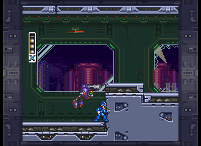
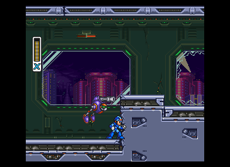

# Rockman X3 (Saturn): Overlay Removal

The Saturn version of Rockman X3 shows the game in a window of 256 x 224 pixels.
A decorated border fills the rest of the 320 x 240 screen.
This patch makes the border black.

The picture is not made wider. The play area, the graphics, the sound and the text are not changed.

| Before                                        | After                                       |
| --------------------------------------------- | ------------------------------------------- |
|  |  |

Screenshots are from Mednafen 1.32.1, on the intro stage.

## What you need

You need your own dump of Rockman X3 (Japan) for the Sega Saturn (T-1210G), version V1.001 (1996-03-25). The dump must be a multi-track BIN/CUE, with one `.bin` file for each of the 31 tracks. Only Track 01 is patched. The European release (Mega Man X3) and other pressings are not supported as of this moment.

| Track 01  | Before the patch                           | After the patch                            |
| --------- | ------------------------------------------ | ------------------------------------------ |
| File name | `Rockman X3 (Japan) (2M) (Track 01).bin`   | the same                                   |
| Size      | 205106160 bytes                            | 205106160 bytes                            |
| CRC32     | `8030be91`                                 | `d9b4d350`                                 |
| MD5       | `47ec4d19ce8826ba541d29b4d031bebd`         | `175bf935a2ba9c080a37515c5232943e`         |
| SHA-1     | `1ef3da9f377899ec9b5edab51c6150ddbe3909b0` | `4d23bb9aefeafc14a94dec869b20a000bcc19c5b` |

## How to patch

1. Make a copy of the dump folder. Keep the original.
2. Open `patch/x3-border-a2.bps` in [Floating IPS](https://github.com/Alcaro/Flips) or [RomPatcher.js](https://www.marcrobledo.com/RomPatcher.js/). Select the Track 01 `.bin` file as the source.
3. Save the output with the same file name as the old Track 01 file, and replace the old file in the copy.
4. Load the `.cue` file as before. The `.cue` file and the other tracks are not changed.

A BPS patcher checks the CRC32 of the source file and stops if the file is wrong. Two other patches are in the `patch` folder. They give the same result.

- `x3-border-a2.ips` is for the same two patchers. IPS has no source check, so check the SHA-1 of Track 01 first.
- `x3-border-a2.xdelta` is for [Delta Patcher](https://github.com/marco-calautti/DeltaPatcher), or `xdelta3 -d -s <Track 01> x3-border-a2.xdelta <output>`.

A single-file BIN, an ISO or a CHD must be converted to a multi-track BIN/CUE first. `chdman extractcd` and `binmerge --split` are common tools for this.

To check the result, compare the SHA-1 of the new Track 01 with the table. Use `sha1sum <file>` on Linux or macOS, and `certutil -hashfile <file> SHA1` on Windows. `patch/checksums.txt` lists the hashes of the patch files. The `tools` folder has Python scripts that do the same work from the command line.

## Tested

The patch was tested in Mednafen 1.32.1 on Windows, and Real Saturn hardware with Fenrir ODE Duo. The patched disc boots, and the intro stage, password screen and the first 8 boss stages were played with black bars.

## Known issues

- The hidden picture under the border is not shown. The border is only made black. This could be added in the future, but requires further work.

## How it works

Four bytes of start-up code in `0X3_SS.BIN` are changed. The border layer (VDP2 NBG0) then uses palette page 1 instead of page 0. On page 1 the border colours are black. The EDC/ECC of the one changed sector is rebuilt. [docs/how-it-works.md](docs/how-it-works.md) has the details, [docs/ram-map.md](docs/ram-map.md) lists the addresses that were found, and [docs/cheats.md](docs/cheats.md) gives the same change as a cheat code.

## Credits

- JasonBlueX found that the game shows a full 4:3 picture when one layer is hidden ([Sonic Retro thread](https://forums.sonicretro.org/threads/a-curious-discovery-from-sega-saturns-mega-man-x3.43927/), 2025-08-05). Chimes, aria, Captain L and Meat Miracle added to the discussion.
- Mednafen and Ymir were used for the tests and the save states. Capstone was used to disassemble the SH-2 code.
- The BPS format is by byuu (Near).

## Version and licence

Version 1.0, 2026-11-15, first release. The tools and the documents are under the MIT licence (see `LICENSE`). The patch contains no game data. You must use your own copy of the game.